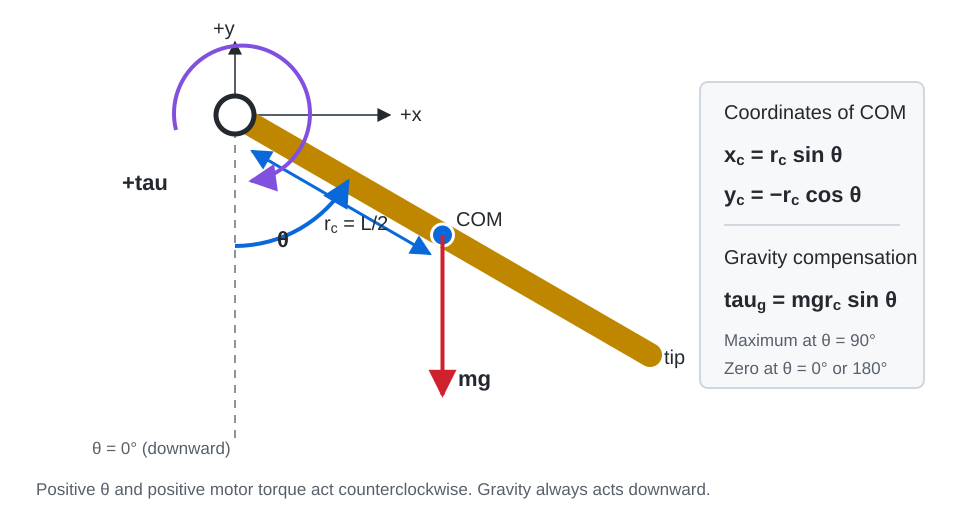
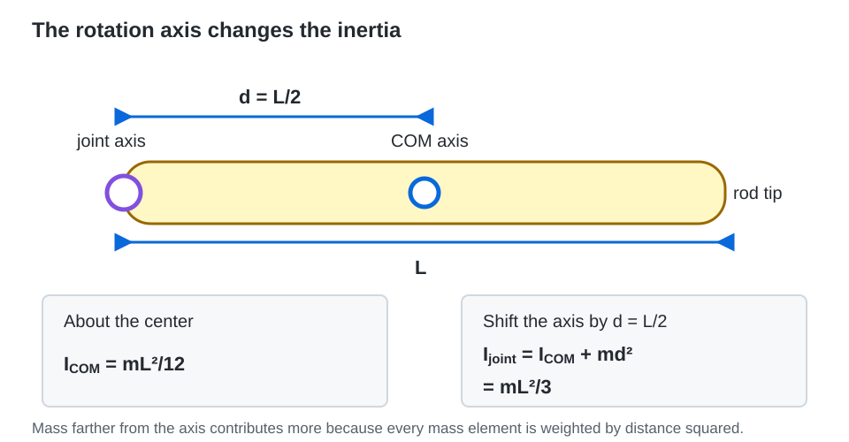
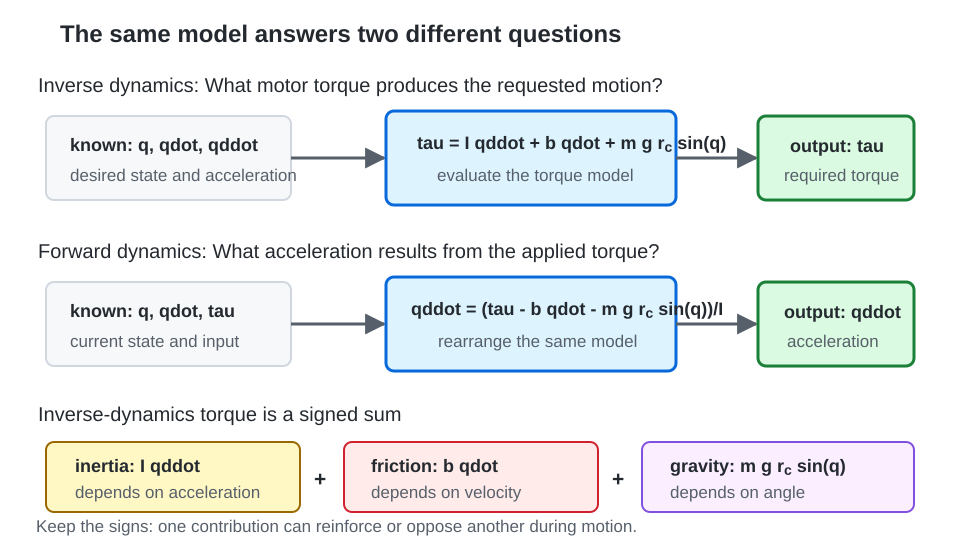

# Manipulator Dynamics: A Simple 1R Arm

This activity introduces manipulator dynamics through a single rotating link. It supplements Craig's Chapter 6 and prepares you for trajectory generation in Chapter 7.

You already know how to find robot positions using forward kinematics, calculate velocities using a Jacobian, and find joint angles using inverse kinematics. Here, you will calculate the **motor torque needed to hold or move an arm**.

The supplied code is complete. Your work is to run it, change parameters, check the results, and explain the physical behavior.

> This is a standalone Python activity. It does not require Webots, a robot model, or a Webots controller. It gives you a simple dynamics model to understand before working with a more detailed simulator.

## Optional conceptual background

For a concepts-first explanation of torque balance, gravity, rotational inertia, inverse and forward dynamics, the energy method, time scaling, and torque limits, read [Manipulator Dynamics Optional Background](OPTIONAL_BACKGROUND.md). The numbered sections below contain the detailed derivations and required activities.

## Learning objectives

After completing the activity, you should be able to:

- Distinguish kinematics from dynamics.
- Explain the inertia, friction, and gravity terms in a joint torque equation.
- Calculate the torque needed to hold a stationary arm.
- Apply the Lagrange equation to a single rotating link.
- Distinguish forward dynamics from inverse dynamics.
- Explain how payload and motion duration affect torque requirements.
- Check whether a desired motion and its final hold satisfy an ideal joint torque limit.

## Files in this folder

| File | Purpose |
|---|---|
| [manipulator_dynamics.ipynb](./manipulator_dynamics.ipynb) | Complete code and activity prompts for Google Colab or Jupyter |
| [manipulator_dynamics.py](./manipulator_dynamics.py) | The same numerical code as a standalone Python script |
| [requirements.txt](./requirements.txt) | Python dependencies: NumPy and Matplotlib |

## Getting started

### Option A: Google Colab

1. Download `manipulator_dynamics.ipynb` from this folder. On GitHub, download the actual notebook file rather than saving the webpage.
2. Open [Google Colab](https://colab.research.google.com/).
3. Upload the notebook through its notebook-opening interface.
4. Run the cells from top to bottom. The first code cell imports the libraries and defines the arm model.
5. Complete Activity 1 and Activity 2, modifying the supplied code as requested.

If a required library is missing, run this in a separate notebook cell, then rerun the imports:

```python
%pip install numpy matplotlib
```

### Option B: Local Python

Use a Python 3 environment. Python 3.10 or later is a suitable choice for these activities.

Open a terminal in this folder and run:

```bash
python -m pip install -r requirements.txt
python manipulator_dynamics.py
```

If your system uses the `python3` command, use it in both commands instead of `python`.

The script prints numerical results and opens plots. Depending on your plotting backend, you may need to close a figure window before the script continues. You can also open the notebook locally in Jupyter or VS Code.

## 1. Arm model and angle convention

The robot has one revolute joint and one uniform rigid link. It moves in a **vertical plane**, so gravity produces torque about the joint.

| Parameter | Symbol | Value |
|---|---|---:|
| Link mass | $m$ | $2.0\ \mathrm{kg}$ |
| Link length | $L$ | $0.6\ \mathrm{m}$ |
| Joint-to-COM distance | $r_c=L/2$ | $0.3\ \mathrm{m}$ |
| Gravity magnitude | $g$ | $10.0\ \mathrm{m/s^2}$ |
| Inertia about the joint | $I=mL^2/3$ | $0.24\ \mathrm{kg\,m^2}$ |
| Viscous friction coefficient | $b$ | $0.1\ \mathrm{N\,m\,s/rad}$ |

We use $g=10\ \mathrm{m/s^2}$ to simplify classroom calculations. Use the same value when comparing your hand calculations with the code.

**COM** means center of mass. For a uniform link, it lies halfway along the link.

- $\theta=0^\circ$: the arm hangs downward.
- $\theta=90^\circ$: the arm points horizontally to the right.
- $\theta=180^\circ$: the arm points upward.
- Positive angle and motor torque act counterclockwise.



*Figure 1. Angle, torque, center-of-mass, and gravity conventions used throughout the activity.*

With the joint at the origin, the COM coordinates are

$$
x_c=r_c\sin\theta,
\qquad y_c=-r_c\cos\theta.
$$

This convention differs from the common planar-arm convention that measures an angle from the positive horizontal axis. Keep the convention consistent when using trigonometric functions.

### Radians and time derivatives

All angles inside the code use **radians**. Convert a degree value before passing it to a model function:

```python
q = np.deg2rad(30.0)
```

| Mathematical quantity | Code name | Units |
|---|---|---|
| Angle $\theta$ | `q` | rad |
| Angular velocity $\dot{\theta}$ | `qd` | rad/s |
| Angular acceleration $\ddot{\theta}$ | `qdd` | rad/s² |
| Motor torque $\tau$ | `tau` | N m |

## 2. The torque equation

The required motor torque is

$$
\boxed{\tau=I\ddot{\theta}+b\dot{\theta}+mgr_c\sin\theta.}
$$

| Term | Meaning | Depends on |
|---|---|---|
| $I\ddot{\theta}$ | Torque associated with angular acceleration | Acceleration |
| $b\dot{\theta}$ | Compensation for modeled viscous friction | Velocity |
| $mgr_c\sin\theta$ | Compensation for gravity | Angle |

The actual gravity torque is $-mgr_c\sin\theta$, and the actual viscous-friction torque is $-b\dot{\theta}$. Moving these terms to the required motor-torque side gives the plus signs above.

Each contribution has a sign. For example, a negative acceleration gives a negative inertial term. Do not replace the terms with their absolute values before adding them.

### Why a stationary arm needs torque

At a stationary hold, $\dot{\theta}=0$ and $\ddot{\theta}=0$, giving

$$
\tau_{\mathrm{hold}}=mgr_c\sin\theta.
$$

For a horizontal arm,

$$
\tau_{\mathrm{hold}}=(2)(10)(0.3)\sin90^\circ=6\ \mathrm{N\,m}.
$$

Zero velocity and acceleration do not imply zero motor torque: the motor must balance gravity.

### Inertia about the joint

Rotational inertia depends on how far the mass lies from the rotation axis. For a uniform slender rod, let $x$ measure distance from its center. Its constant mass per unit length is $m/L$, so a small piece of length $dx$ has mass $dm=(m/L)dx$. The inertia about the center of mass is therefore



*Figure 2. The rod is unchanged, but moving the rotation axis from the COM to the end increases its inertia.*

$$
I_{\mathrm{COM}}
=\int_{-L/2}^{L/2}x^2\,dm
=\int_{-L/2}^{L/2}x^2\frac{m}{L}\,dx
=\frac{mL^2}{12}.
$$

The 1R arm rotates about the joint at the end of the rod, a distance $L/2$ from the COM. Apply the parallel-axis theorem:

$$
I_{\mathrm{joint}}
=I_{\mathrm{COM}}+m\left(\frac{L}{2}\right)^2
=\frac{mL^2}{12}+\frac{mL^2}{4}
=\frac{mL^2}{3}.
$$

Thus, $mL^2/12$ is the inertia about the rod's center, while $mL^2/3$ is the inertia about its end joint. The 1R torque equation must use $I_{\mathrm{joint}}$ because that is the axis about which the link actually rotates.

## Activity 1: Holding torque and payload

Run the setup cell and the Activity 1 cell in the notebook.

### Before running

Predict the holding torque at $0^\circ$, $30^\circ$, $90^\circ$, and $180^\circ$. Explain which orientation needs the greatest holding torque.

### What the supplied code does

1. Sweeps the arm angle from $0^\circ$ to $180^\circ$.
2. Calculates the stationary holding torque.
3. Plots two cases: no payload and a $0.5\ \mathrm{kg}$ point payload at the tip.
4. Prints the horizontal holding torque for both cases.

### Payload model

A point payload of mass $m_p$ adds inertia and gravity torque:

$$
I_{\mathrm{new}}=I+m_pL^2,
$$

$$
\tau=I_{\mathrm{new}}\ddot{\theta}+b\dot{\theta}
+(mgr_c+m_pgL)\sin\theta.
$$

The payload sits at distance $L$ from the joint, while the link's COM sits at distance $r_c$.

### Tasks

1. Record the predicted and calculated no-payload torques at the four specified angles.
2. Report the horizontal holding torque with the $0.5\ \mathrm{kg}$ payload.
3. Change the payload to `1.0` kg in the holding-torque loop. Describe how the curve changes.
4. Explain why the holding torque is zero at $180^\circ$ in this ideal model. Does zero gravity torque make the upward pose stable?
5. Consider an arm rotating on a horizontal tabletop with a vertical joint axis. Would gravity produce the same joint torque? Explain using the COM height.

### Baseline checks

Without a payload, the torques at $0^\circ$, $30^\circ$, $90^\circ$, and $180^\circ$ should be approximately $0$, $3$, $6$, and $0\ \mathrm{N\,m}$. Floating-point calculations may print a tiny nonzero value at $180^\circ$.

With a $0.5\ \mathrm{kg}$ tip payload, the horizontal holding torque should be $9\ \mathrm{N\,m}$.

> The upward pose has zero ideal gravity torque exactly at $180^\circ$, but it is an unstable equilibrium without stabilizing control. A small disturbance can make the arm fall away from that pose.

## 3. Energy method: a short 1R derivation

For this arm, the kinetic and potential energies are

$$
T=\frac12I\dot{\theta}^2,
\qquad
V=mgr_c(1-\cos\theta).
$$

Potential energy is zero in the downward pose. At angle $\theta$, the COM has risen by $r_c(1-\cos\theta)$.

Define the Lagrangian as $\mathcal L=T-V$. The Lagrange equation, including the separately modeled viscous friction, gives

$$
\tau=\frac{d}{dt}\left(\frac{\partial\mathcal L}{\partial\dot{\theta}}\right)
-\frac{\partial\mathcal L}{\partial\theta}+b\dot{\theta}.
$$

Take the derivatives in this order:

$$
\frac{\partial\mathcal L}{\partial\dot{\theta}}=I\dot{\theta},
\qquad
\frac{d}{dt}(I\dot{\theta})=I\ddot{\theta},
$$

$$
\frac{\partial\mathcal L}{\partial\theta}=-mgr_c\sin\theta.
$$

Substitution recovers the torque equation from Section 2.

When taking these partial derivatives, treat angle and angular velocity as independent arguments of $\mathcal L(\theta,\dot{\theta})$. Hold one fixed while differentiating with respect to the other. Along an actual motion, $\dot{\theta}$ is still the time derivative of $\theta$.

## 4. Inverse dynamics and forward dynamics



*Figure 3. Inverse and forward dynamics use the same physical model but solve for different unknowns.*

**Inverse dynamics** calculates the torque needed for a specified angle, velocity, and acceleration:

```python
tau = inverse_1r(q, qd, qdd, payload=0.0)
```

**Forward dynamics** calculates acceleration from the current state and applied torque:

$$
\ddot{\theta}=\frac{\tau-b\dot{\theta}-mgr_c\sin\theta}{I}.
$$

```python
qdd = acceleration_1r(q, qd, tau, payload=0.0)
```

For example, releasing the no-payload arm at $30^\circ$ with zero velocity and zero applied torque gives an initial acceleration of $-12.5\ \mathrm{rad/s^2}$. The negative sign means that it initially accelerates toward the downward pose.

Calculating acceleration at one instant does not give a complete motion simulation. A forward simulation would repeatedly integrate acceleration and velocity to update the state. The compact notebook focuses on required torque rather than simulating tracking.

## Activity 2: Motion duration and required torque

Move the arm from $0^\circ$ to $90^\circ$, starting and ending with zero angular velocity. Compare motion durations of $2\ \mathrm{s}$ and $1\ \mathrm{s}$.

This activity is suitable for homework after the second 50-minute class meeting. During class, the instructor can demonstrate the supplied plots and discuss the predictions.

### Supplied cubic trajectory

Let $T_f$ be the motion duration, $s=t/T_f$, and $\Delta\theta=\theta_f-\theta_0$. For $0\le t\le T_f$,

$$
\theta(t)=\theta_0+\Delta\theta(3s^2-2s^3),
$$

$$
\dot{\theta}(t)=\frac{\Delta\theta}{T_f}(6s-6s^2),
$$

$$
\ddot{\theta}(t)=\frac{\Delta\theta}{T_f^2}(6-12s).
$$

The symbol $T$ earlier denotes kinetic energy. Here, $T_f$ denotes duration.

The code supplies this trajectory through `cubic_trajectory(duration)`. A full derivation of the cubic coefficients belongs to the trajectory-generation lesson.

### What the supplied code does

1. Generates the angle, velocity, and acceleration profiles.
2. Calculates the required torque using inverse dynamics.
3. Plots the two motion durations.
4. Prints peak absolute velocity, acceleration, inertial torque, and total torque.
5. Checks an ideal symmetric joint torque limit of $\pm6\ \mathrm{N\,m}$, both during the sampled motion and at the subsequent stationary hold.
6. Repeats the torque-limit check with a $0.5\ \mathrm{kg}$ tip payload.

### Tasks

1. Before running, predict how peak velocity and acceleration change when the duration halves.
2. Record the peak values for the $2\ \mathrm{s}$ and $1\ \mathrm{s}$ motions.
3. Explain why peak inertial torque and peak total torque do not necessarily scale by the same factor.
4. Report whether each no-payload motion and its final hold meet the torque limit.
5. Repeat the check with the $0.5\ \mathrm{kg}$ payload. Explain whether increasing the duration can make the final pose feasible under the same limit.
6. Try a $4\ \mathrm{s}$ motion. Describe which torque contribution changes with duration and which remains fixed at a given pose.

To add a duration, change the duration list in both the plotting loop and the torque-limit loop:

```python
for duration in [2.0, 1.0, 4.0]:
```

The holding-torque plot and the motion-limit check each have their own payload loop. Change the loop relevant to the experiment you are running, and keep a copy of the baseline results for comparison.

### Baseline checks: no payload

| Quantity | $T_f=2\ \mathrm{s}$ | $T_f=1\ \mathrm{s}$ |
|---|---:|---:|
| Peak absolute velocity (rad/s) | 1.178 | 2.356 |
| Peak absolute acceleration (rad/s²) | 2.356 | 9.425 |
| Peak absolute inertial torque (N m) | 0.565 | 2.262 |
| Sampled peak absolute total torque during the cubic (N m) | 5.656 | 4.965 |
| Torque at the subsequent stationary final hold (N m) | 6.000 | 6.000 |

Peak velocity doubles and peak acceleration quadruples. Inertial torque therefore quadruples for this fixed-inertia arm.

The faster motion has a smaller peak **total** torque in this particular example. During deceleration, the negative inertial term counteracts the positive gravity term. Total torque depends on the signed sum of all contributions, so a faster motion does not universally produce a larger total peak.

At the same normalized path point $s$, the gravity contribution is unchanged, the viscous-friction contribution doubles, and the inertial contribution quadruples when duration halves. The maximum of their sum can occur at a different path point.

### Why the final hold matters

The torque needed to hold the final pose is different from the torque at the end of the decelerating cubic motion. At the stationary hold, velocity and acceleration are both zero.

A $0.5\ \mathrm{kg}$ tip payload needs $9\ \mathrm{N\,m}$ to hold the final horizontal pose. Increasing the motion duration cannot remove this gravity requirement. Under the ideal $\pm6\ \mathrm{N\,m}$ joint torque limit, that final hold is infeasible.

### Endpoint acceleration

This cubic has zero endpoint velocity but nonzero endpoint acceleration. Joining it to a stationary hold creates an acceleration change and can create a torque jump. A later Chapter 7 lesson can introduce quintic trajectories with zero endpoint acceleration.

## What to submit

Follow the instructor's Canvas assignment for the due date and any additional requirements. For these activities, submit:

1. Your edited notebook or Python script.
2. The Activity 1 holding-torque plot, with a brief payload explanation.
3. The Activity 2 motion comparison plots.
4. A table of the motion's peak values and your torque-limit conclusions.
5. Short responses to the activity questions, with units in all numerical results.

Explain the trends in your own words. A plot or numerical answer alone does not show why the arm behaves that way.

## Suggested use in two 50-minute meetings

| Meeting | Topic | Approximate allocation |
|---|---|---:|
| 1 | Torque, inertia, gravity, and payload | 25 min |
| 1 | Two classroom polls and discussion | 10 min |
| 1 | Activity 1 and debrief | 15 min |
| 2 | Energy method and the 1R derivation | 20 min |
| 2 | Forward dynamics and a classroom poll | 10 min |
| 2 | Motion-time demonstration and final poll | 15 min |
| 2 | Wrap-up and homework instructions | 5 min |

Complete local installation before class if you choose the local Python option. Activity 2 is the follow-up coding assignment.

## Troubleshooting

| Problem | Check |
|---|---|
| `ModuleNotFoundError` for NumPy or Matplotlib | Install the dependencies using the same Python interpreter that runs the script. |
| `NameError` in the notebook | Run the setup cell before the activity cells, or rerun all cells in order. |
| Unexpected trigonometric results | Convert degrees to radians before passing an angle to the model. |
| Incorrect inertia | Use inertia about the joint: $mL^2/3$. |
| Strange torque signs | Check the downward-zero angle convention and the sign of velocity/acceleration. |
| Script pauses after displaying a plot | Close the figure window so execution can continue. |
| Motion passes a torque check but final pose does not | Include the subsequent stationary hold in the feasibility check. |
| Results differ slightly from the table | Check parameters, rounding, and sample count. The supplied trajectory uses 2,001 samples. |

If you modify `m` or `L`, recompute `rc` and `I` by rerunning the setup cell. The initial parameters are defined once; changing a mass variable later does not automatically update derived values.

## Model assumptions and connection to Webots

The teaching model assumes a rigid uniform link, a fixed joint, a point payload at the tip, and viscous friction. It omits motor electrical dynamics, gear losses, Coulomb/static friction, link flexibility, joint stops, and external contact forces.

The torque check uses an ideal symmetric limit on **joint-output torque**. It does not model saturation, speed-dependent motor limits, or closed-loop tracking. Sampled torque checks are useful estimates, not a proof of continuous-time feasibility.

When applying these ideas in a Webots lab, first identify the robot model's joint axis, angle reference, link mass, COM position, inertia, and actuator limits. Use the simulator's parameters instead of assuming that this activity's values apply. A position-commanded motor may provide its own feedback behavior, so a desired position trajectory and a direct torque command require different controller setups.

## References

- John J. Craig, *Introduction to Robotics: Mechanics and Control*: selected concepts from Chapter 6, followed by Chapter 7.
- Kevin M. Lynch and Frank C. Park, [Modern Robotics: Lagrangian Formulation of Dynamics](https://modernrobotics.northwestern.edu/nu-gm-book-resource/chapter-8-1-lagrangian-formulation-of-dynamics-part-1-of-2/).

The numerical parameters, coding activities, and worked examples in this folder are teaching examples for EEL 4664.
