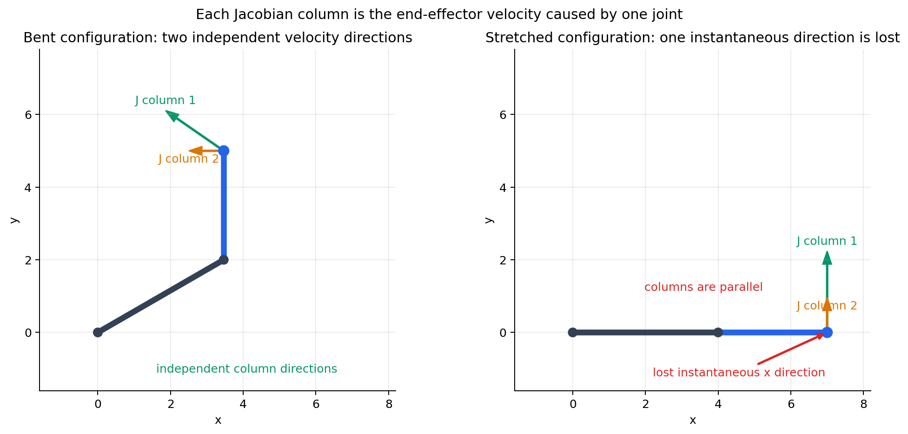

# Lab 4 Optional Background

This page explains the ideas behind differential kinematics and singularities before the detailed implementation. Read Sections 1 through 7 for the core concepts. The remaining sections help interpret the numerical experiment.

Return to the [Lab 4 instructions](README.md) when you are ready to complete the required activity.

## 1. The Jacobian is a local motion map

Forward kinematics maps joint angles to a tool pose:

$$
\mathbf x=f(\mathbf q).
$$

Near the current configuration, a small joint change produces an approximately linear tool-pose change:

$$
\Delta\mathbf x\approx J(\mathbf q)\Delta\mathbf q.
$$

Dividing by a small time interval gives the velocity form:

$$
\begin{bmatrix}\mathbf v\\\boldsymbol\omega\end{bmatrix}
=J(\mathbf q)\dot{\mathbf q}.
$$

The Jacobian plays the role of a multivariable derivative. It is local: after the robot moves, the Jacobian must be recalculated at the new configuration.

## 2. Build intuition with a planar 2R arm

Before using the six-joint UR5e, consider a two-link planar arm. Its endpoint position is

$$
x=L_1\cos\theta_1+L_2\cos(\theta_1+\theta_2),
$$

$$
y=L_1\sin\theta_1+L_2\sin(\theta_1+\theta_2).
$$

Differentiate these forward-kinematics equations with respect to time. Collecting the coefficients of $\dot\theta_1$ and $\dot\theta_2$ gives

$$
\begin{bmatrix}\dot x\\\dot y\end{bmatrix}
=J(\mathbf q)
\begin{bmatrix}\dot\theta_1\\\dot\theta_2\end{bmatrix}.
$$

where

$$
J(\mathbf q)=
\begin{bmatrix}
-L_1\sin\theta_1-L_2\sin(\theta_1+\theta_2) & -L_2\sin(\theta_1+\theta_2)\\
L_1\cos\theta_1+L_2\cos(\theta_1+\theta_2) & L_2\cos(\theta_1+\theta_2)
\end{bmatrix}.
$$

This is the same multivariable derivative introduced in Section 1:

$$
J_{ij}=\frac{\partial x_i}{\partial q_j}.
$$

Read the matrix one column at a time. If joint 1 moves at $1$ rad/s while joint 2 is stationary, the endpoint velocity equals column 1. If only joint 2 moves at $1$ rad/s, it equals column 2.

For $L_1=4$, $L_2=3$, $\theta_1=30^\circ$, and $\theta_2=60^\circ$,

$$
J=
\begin{bmatrix}
-5.000 & -3.000\\
3.464 & 0.000
\end{bmatrix}.
$$

With $\dot{\mathbf q}=[0.2,\ 0.1]^T$ rad/s,

$$
\dot{\mathbf x}=J\dot{\mathbf q}=\begin{bmatrix}-1.300\\0.693\end{bmatrix}.
$$

The negative $x$ component and positive $y$ component mean that the endpoint moves left and upward.



*Each arrow shows the endpoint velocity produced by one joint moving alone. In the stretched configuration, both columns point vertically, so combining them cannot produce instantaneous horizontal velocity.*

At the stretched configuration $\theta_1=\theta_2=0$,

$$
J=
\begin{bmatrix}
0 & 0\\
L_1+L_2 & L_2
\end{bmatrix}=
\begin{bmatrix}
0 & 0\\
7 & 3
\end{bmatrix}.
$$

The two columns are parallel, the rank falls from two to one, and $\det(J)=0$. The arm can create vertical endpoint velocity but cannot create horizontal endpoint velocity at that instant. For this square 2R example, a zero determinant identifies singularity. For general robot tasks, the Jacobian may be nonsquare, so rank and singular values are the more useful tests.

## 3. Why one revolute-joint column contains a cross product

For revolute joint $i$, let $\mathbf z_i$ be its axis direction, $\mathbf p_i$ a point on the axis, and $\mathbf p_e$ the endpoint position, all expressed in the base frame.

A small positive joint rotation produces tangential endpoint velocity:

$$
\mathbf v_i=\mathbf z_i\times(\mathbf p_e-\mathbf p_i)\dot q_i.
$$

The same joint produces angular velocity along its axis:

$$
\boldsymbol\omega_i=\mathbf z_i\dot q_i.
$$

Therefore,

$$
J_i=
\begin{bmatrix}
\mathbf z_i\times(\mathbf p_e-\mathbf p_i)\\
\mathbf z_i
\end{bmatrix}.
$$

Each column answers: “If only this joint moves at one radian per second, what instantaneous linear and angular tool velocity results?”

## 4. A singularity is a lost motion direction

Away from a singularity, the robot can create small tool motion in every task direction represented by the Jacobian. At a singularity, the Jacobian loses rank. At least one desired Cartesian direction can no longer be produced instantaneously, regardless of how the joints are combined.

This is a geometric limitation, not merely a failed matrix calculation. Near a singularity, the direction may still be approximated, but doing so can require impractically large joint rates.

## 5. SVD reveals strong and weak directions

The singular value decomposition is

$$
J=U\Sigma V^T.
$$

The columns of $V$ describe joint-velocity directions. The columns of $U$ describe corresponding tool-twist directions. The singular values describe how strongly each joint direction produces its associated tool motion:

$$
J\mathbf v_i=\sigma_i\mathbf u_i.
$$

A large $\sigma_i$ means the robot produces that tool direction efficiently. A small $\sigma_i$ identifies weak motion capability. Thus:

- $\sigma_{\min}$ measures the weakest local motion direction;
- $\mathbf u_{\min}$ identifies the degraded tool-twist direction; and
- $\mathbf v_{\min}$ identifies the associated joint-motion combination.

At an exact singularity, $\sigma_{\min}=0$.

## 6. Why the pseudoinverse can request extreme joint rates

A common inverse differential solution is

$$
\dot{\mathbf q}=J^+\mathbf v_d.
$$

In SVD form, the pseudoinverse divides by each nonzero singular value. A requested component aligned with $\mathbf u_{\min}$ is amplified approximately by $1/\sigma_{\min}$. As $\sigma_{\min}$ approaches zero, the requested joint-rate norm can become very large.

## 7. Damped least squares limits amplification

Damped least squares uses

$$
\dot{\mathbf q}
=J^T\left(JJ^T+\lambda^2I\right)^{-1}\mathbf v_d.
$$

The damping parameter $\lambda$ prevents division by a nearly zero singular value. Small damping preserves accuracy when the robot is well conditioned. Larger damping bounds joint-rate amplification near a singularity but accepts Cartesian tracking error.

Damping does not remove the singularity or restore the lost physical motion direction.

## 8. Metrics describe different aspects of conditioning

Common metrics include

$$
\kappa(J)=\frac{\sigma_{\max}}{\sigma_{\min}}
$$

and Yoshikawa manipulability

$$
w=\sqrt{\det(JJ^T)}=\prod_i\sigma_i.
$$

Near a singularity, $\sigma_{\min}$ and $w$ approach zero, while the condition number grows. Rank depends on a numerical tolerance, so report the tolerance used. A determinant alone does not identify the lost direction and is not defined for a nonsquare Jacobian.

## 9. Translation and rotation use different units

A 6D geometric Jacobian contains translational rows and rotational rows. Changing meters to millimeters changes raw singular values and condition number even though the physical robot is unchanged.

Use the stated SI-unit convention consistently in this lab. For more general comparisons, report a characteristic length or analyze position and orientation blocks separately. Never compare conditioning values produced with different unit scalings.

## 10. Verify before interpreting a singularity

A forward difference follows the most direct experiment: compute the current pose, perturb only joint $i$, recompute the pose, and divide the observed change by the joint perturbation:

$$
J[:,i]\approx
\frac{\mathrm{poseDifference}(T(\mathbf q),
T(\mathbf q+\varepsilon\mathbf e_i))}
{\varepsilon}.
$$

Here, $\mathbf e_i$ is a unit vector that selects joint $i$. Both $\mathbf q$ and $\varepsilon$ must use radians. Repeating the experiment one joint at a time builds the Jacobian one column at a time without explicitly differentiating the FK equations.

The lab uses a centered difference because it usually gives a more accurate estimate for the same step size:

A centered finite difference estimates each column:

$$
J[:,i]\approx
\frac{\mathrm{poseDifference}(T(\mathbf q-\varepsilon\mathbf e_i),
T(\mathbf q+\varepsilon\mathbf e_i))}
{2\varepsilon}.
$$

Try several values of $\varepsilon$. A large value measures motion over too wide a neighborhood and is no longer a good local derivative. An extremely small value exposes floating-point roundoff. A useful implementation should show a range in which the analytical and numerical Jacobians agree closely.

Both Jacobians must use the same endpoint and frame. A frame, sign, or endpoint mismatch creates error broadly. A real singularity instead appears with analytical/numerical agreement, a small singular value, and amplified inverse motion.

```text
verify FK
    -> verify one Jacobian column
    -> verify all columns
    -> inspect singular values
    -> command a very small differential motion
    -> approach the singularity conservatively
```
