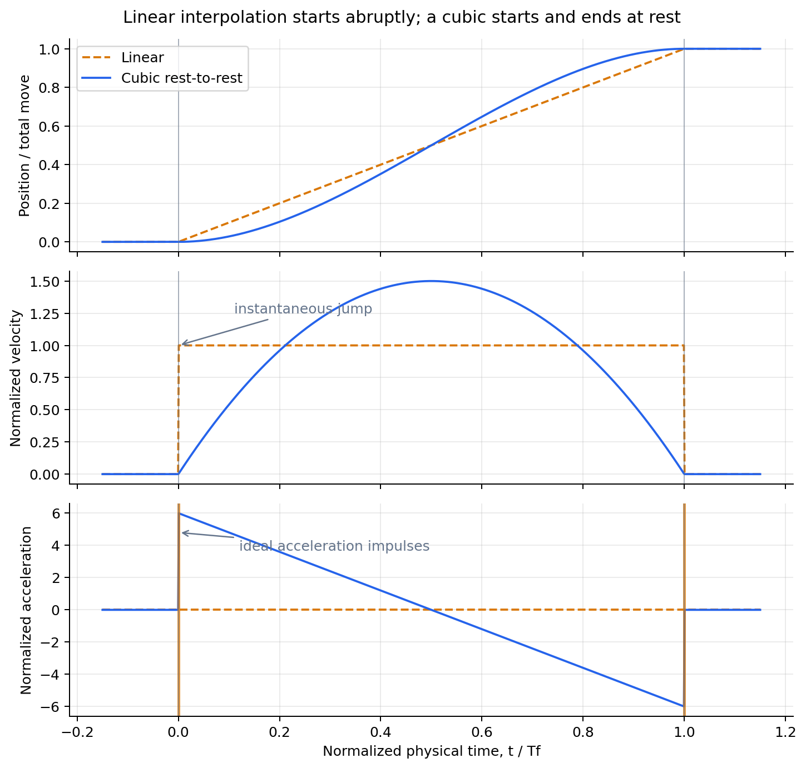
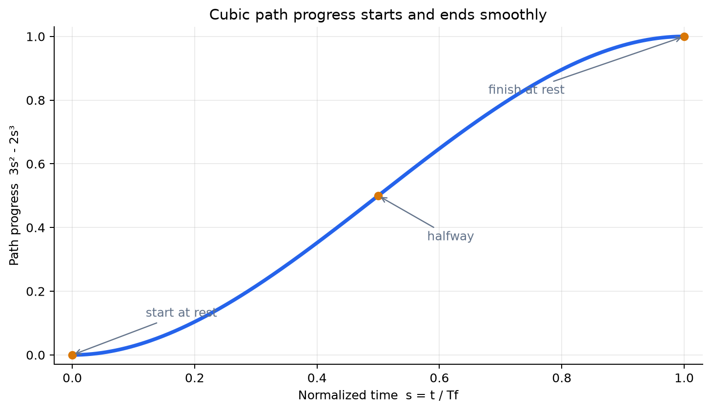
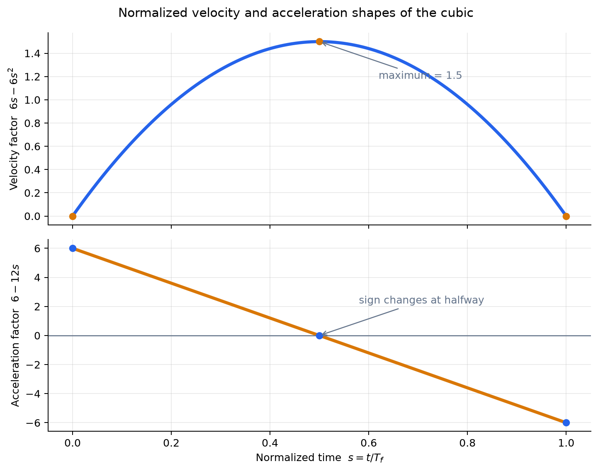
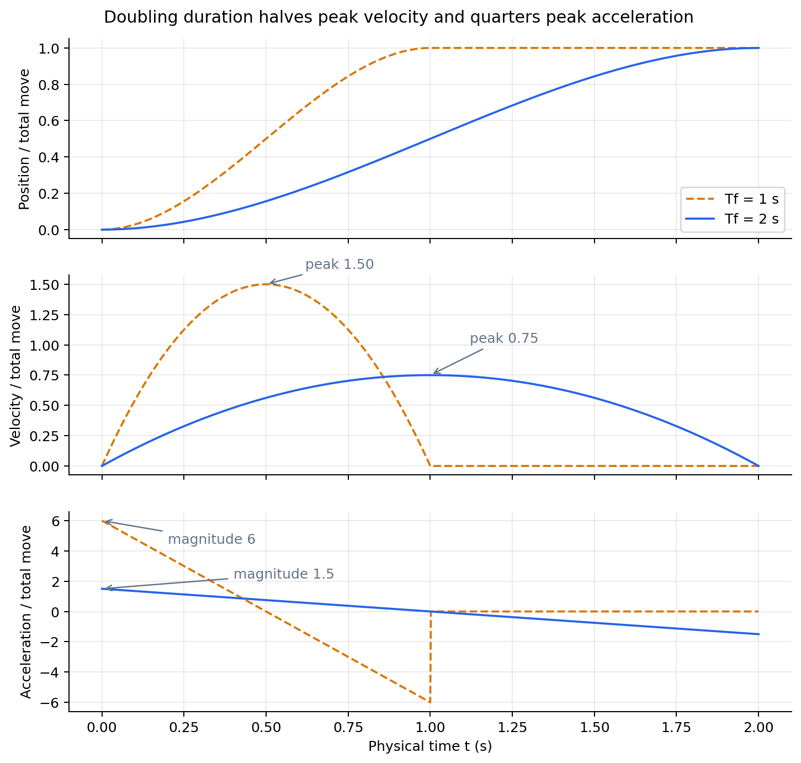
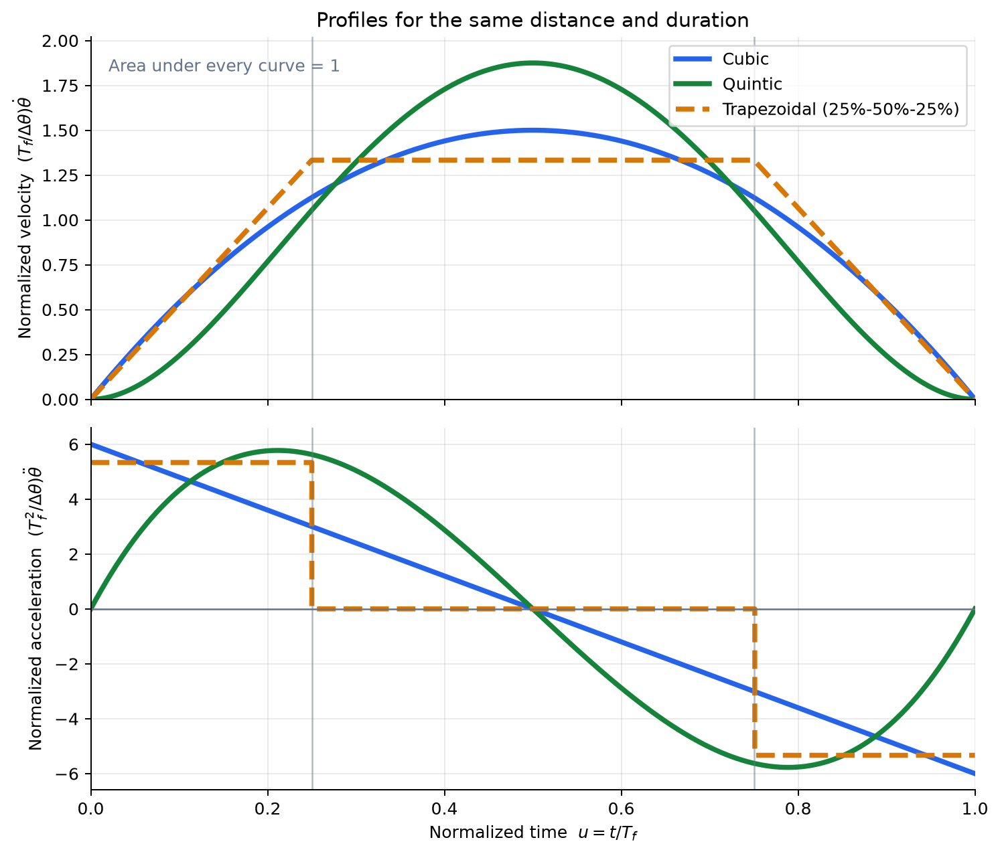
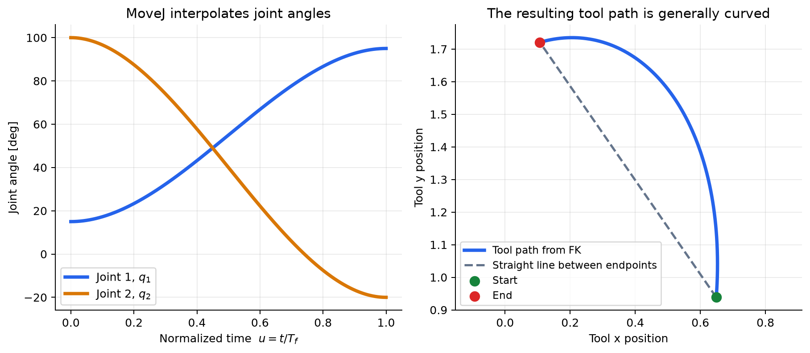
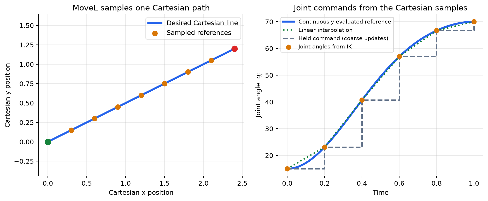
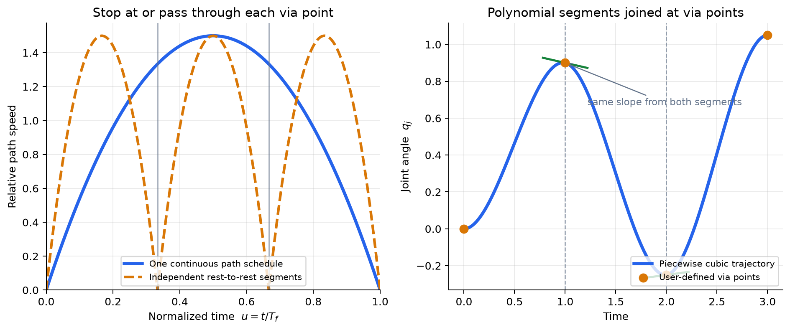

# Lab 5 Optional Background

This page explains the main ideas behind trajectory generation and tracking. Read Sections 1 through 6 before the lab if you want a concepts-first introduction. Sections 7 through 11 provide additional detail and are useful when interpreting your plots.

Return to the [Lab 5 instructions](README.md) when you are ready to complete the required activity.

## 1. A path says where; a trajectory also says when

A **path** describes the geometric route taken by the robot. It does not specify how quickly the robot travels along that route.

A **trajectory** assigns a time to every point on the path. It specifies position and usually velocity and acceleration as functions of time:

$$
\mathbf q(t),\qquad \dot{\mathbf q}(t),\qquad \ddot{\mathbf q}(t).
$$

For one joint, imagine drawing a curve of angle versus time. The height of the curve is the joint angle, its slope is angular velocity, and the rate at which the slope changes is angular acceleration.

This distinction matters because two motions can follow the same path but use different durations. The slower motion usually requires smaller velocity and acceleration, even though its start and finish are unchanged.

## 2. Start with the simplest choice: a straight line in time

Suppose one joint must move from angle $\theta_0$ at time $0$ to angle $\theta_f$ at time $T_f$. The simplest interpolation is a linear function:

$$
\theta(t)=at+b.
$$

There are two unknown coefficients, so use the two position constraints

$$
\theta(0)=\theta_0,
\qquad
\theta(T_f)=\theta_f.
$$

The first constraint gives $b=\theta_0$. Substituting this into the second constraint gives

$$
\theta_f=aT_f+\theta_0,
$$

and therefore

$$
a=\frac{\theta_f-\theta_0}{T_f}.
$$

The resulting trajectory and velocity are

$$
\theta(t)=\theta_0+\frac{\theta_f-\theta_0}{T_f}t,
$$

$$
\dot{\theta}(t)=\frac{\theta_f-\theta_0}{T_f}.
$$

The position is continuous, but the joint is normally stationary before and after the commanded move. Its desired velocity must therefore jump instantly from zero to a nonzero constant at $t=0$, then jump back to zero at $t=T_f$. An ideal instantaneous velocity change requires unbounded acceleration. A real actuator cannot do this, so it produces a large acceleration and torque transient: the motion starts and stops abruptly.



*Linear interpolation satisfies the two position constraints, but it cannot also impose zero endpoint velocities. The vertical orange marks represent the idealized acceleration impulses associated with its velocity jumps.*

## 3. Add two constraints with a cubic polynomial

To make the joint start and finish at rest, add two velocity constraints. Four total constraints require four adjustable coefficients, so choose a cubic:

$$
\theta(t)=a_0+a_1t+a_2t^2+a_3t^3.
$$

Differentiate once to obtain velocity and again to obtain acceleration:

$$
\dot{\theta}(t)=a_1+2a_2t+3a_3t^2,
$$

$$
\ddot{\theta}(t)=2a_2+6a_3t.
$$

A common rest-to-rest motion uses

$$
\theta(0)=\theta_0,
\qquad
\theta(T_f)=\theta_f,
$$

$$
\dot{\theta}(0)=0,
\qquad
\dot{\theta}(T_f)=0.
$$

Solving these four equations gives

$$
a_0=\theta_0,
\qquad
a_1=0,
$$

$$
a_2=\frac{3(\theta_f-\theta_0)}{T_f^2},
\qquad
a_3=\frac{-2(\theta_f-\theta_0)}{T_f^3}.
$$

The boundary conditions are not checks added after the trajectory is generated. They determine its coefficients. A linear polynomial has only two coefficients and can satisfy only the two position constraints; a cubic has four coefficients and can satisfy both position and velocity constraints.

## 4. A normalized clock makes the formula easier to read

Define normalized time

$$
s=\frac{t}{T_f},\qquad 0\le s\le 1,
$$

and the total angle change

$$
\Delta\theta=\theta_f-\theta_0.
$$

The same cubic rest-to-rest trajectory becomes

$$
\theta(t)=\theta_0+\Delta\theta(3s^2-2s^3).
$$

The function $3s^2-2s^3$ starts at zero, ends at one, and has zero slope at both ends. It describes **progress along the path**. The endpoints determine where the robot goes, while $T_f$ determines how quickly it gets there.



*The horizontal axis is normalized time $s=t/T_f$; the vertical axis is the completed fraction of the motion. At $s=0.5$, the trajectory is halfway to its endpoint.*

For a move from $0^\circ$ to $90^\circ$ in $2$ seconds,

$$
\theta(t)=\frac{3\pi}{8}t^2-\frac{\pi}{8}t^3.
$$

At $t=1$ second, the motion is halfway through its duration and the joint reaches $45^\circ$.

## 5. Why changing duration changes velocity and acceleration

Differentiate the normalized cubic:

$$
\dot{\theta}(t)=\frac{\Delta\theta}{T_f}(6s-6s^2),
$$

$$
\ddot{\theta}(t)=\frac{\Delta\theta}{T_f^2}(6-12s).
$$

The factors $6s-6s^2$ and $6-12s$ describe the shapes of the velocity and acceleration curves. Every complete motion passes through the same normalized interval $0\le s\le1$, regardless of $T_f$. Changing $T_f$ stretches or compresses those shapes along the physical-time axis.



*The velocity factor is zero at both endpoints and largest at $s=0.5$. The acceleration factor changes sign there, marking the transition from speeding up to slowing down.*

Let the velocity-shape factor be

$$
v_s(s)=6s-6s^2.
$$

Its slope is

$$
v_s'(s)=6-12s.
$$

Setting the slope to zero gives $s=0.5$. To determine whether this point is a maximum or minimum, differentiate once more:

$$
v_s''(s)=\frac{d}{ds}(6-12s)=-12.
$$

The second derivative is negative because the slope $6-12s$ continually decreases as $s$ increases. The slope is positive before $s=0.5$ and negative afterward, so the velocity-shape curve first rises and then falls. Therefore, $s=0.5$ is its maximum. The maximum value is

$$
6(0.5)-6(0.5)^2=1.5.
$$

Consequently,

$$
\max |\dot{\theta}|=\frac{1.5|\Delta\theta|}{T_f}.
$$

Similarly, the largest magnitude of $6-12s$ on $0\le s\le1$ is $6$, so

$$
\max |\ddot{\theta}|=\frac{6|\Delta\theta|}{T_f^2}.
$$

These results reveal the time-scaling rule:

- velocity is proportional to $1/T_f$;
- acceleration is proportional to $1/T_f^2$.

If the same motion takes twice as long, its peak velocity is cut in half and its peak acceleration becomes one quarter as large. This statement compares peak values over each complete motion, or values at the same normalized progress $s$; it does not compare the trajectories at the same physical time $t$.



*Both motions follow the same normalized cubic shape. The two-second motion traverses it more slowly: its peak velocity is half as large and its peak acceleration magnitude is one quarter as large.*

This is why slowing a motion often reduces actuator demand. It does not, however, change gravity torque at a given pose or make an unreachable pose reachable.

## 6. Cubic, quintic, and trapezoidal profiles

A cubic rest-to-rest trajectory guarantees zero endpoint velocity, but its acceleration is generally nonzero at both endpoints. Before the motion begins and after it ends, a stationary hold has a constant position reference, so its reference velocity and acceleration are zero. Starting the cubic therefore jumps from zero to nonzero acceleration, and finishing it jumps back to zero acceleration. These abrupt changes can cause corresponding jumps in motor-torque demand.

A quintic time-scaling function has enough coefficients to set position, velocity, and acceleration at both endpoints. A common normalized form is

$$
s(u)=10u^3-15u^4+6u^5,\qquad u=\frac{t}{T_f}.
$$

Use it in

$$
\theta(t)=\theta_0+(\theta_f-\theta_0)s(u).
$$

The quintic begins and ends with zero velocity and zero acceleration, so the transition from moving to remaining stationary is smoother.

A trapezoidal velocity profile uses three phases: accelerate, travel at approximately constant speed, then decelerate. It is easy to interpret and can directly reflect velocity and acceleration limits. The corners of an ideal trapezoid imply acceleration changes; practical controllers may round them.



*Top: all three velocity curves cover the same distance in the same duration, so each has unit area. Bottom: the cubic has nonzero endpoint acceleration, the quintic starts and ends at zero acceleration, and the ideal trapezoid has abrupt acceleration changes at its phase boundaries. The illustrated trapezoid accelerates for 25% of the motion, cruises for 50%, and decelerates for 25%.*

No profile is universally best:

| Profile | Advantages | Disadvantages |
|---|---|---|
| Cubic | Simple formula; zero velocity at both endpoints; moderate peak velocity for a fixed move and duration | Acceleration is nonzero at both endpoints, so starting and ending the motion create acceleration jumps and may cause torque-demand jumps |
| Quintic | Zero velocity and acceleration at both endpoints; smooth transition to remaining stationary | Higher peak velocity for the same move and duration; more coefficients and constraints to calculate |
| Trapezoidal velocity | Directly incorporates velocity and acceleration limits; easy to interpret; can include a constant-speed cruise | Ideal corners create acceleration jumps and infinite jerk; sensitive mechanisms often require rounded corners or an S-curve |

In practice, many industrial point-to-point controllers use trapezoidal velocity profiles or jerk-limited **S-curves**, which round the trapezoid's corners to reduce vibration and mechanical shock. Quintic profiles are also common when zero endpoint velocity and acceleration are important. The exact profile depends on the robot and controller, so choose it from the required smoothness, motion time, and actuator limits rather than appearance alone.

## 7. Synchronizing several joints

For a multi-joint robot, use the same progress function $s(t)$ for every joint:

$$
q_i(t)=q_{i,0}+\left(q_{i,f}-q_{i,0}\right)s(t).
$$

All joints start and finish together because they share the same duration and normalized clock. Each joint still travels a different angular distance and therefore has its own peak velocity and acceleration.

The duration must satisfy the limits of every joint. One slow or heavily loaded joint can determine the minimum feasible duration for the whole synchronized move.

## 8. Joint-space motion (MoveJ)

A **MoveJ-style motion** is a joint-space move: the `J` means **joint**. The controller starts from the current joint angles, interpolates each joint toward its target angle, and synchronizes the joints so they finish together. This usually produces simple, smooth joint commands, but it does not directly control the path taken by the tool.

The tool pose is obtained from the changing joint angles through forward kinematics:

$$
\mathbf x(t)=f\left(\mathbf q(t)\right).
$$

Because forward kinematics is nonlinear, smoothly interpolated joint angles usually produce a curved tool path rather than a straight Cartesian line. MoveJ is useful when smooth, efficient joint motion matters more than the exact path between the endpoints.



*The joints follow synchronized, smooth profiles, but forward kinematics maps them to a curved tool path. The dashed line is shown only for comparison; MoveJ does not command the tool to follow it.*

## 9. Cartesian motion (MoveL) and waypoints

A **MoveL-style motion** commands a Cartesian path: the `L` means **linear**. For a straight position segment,

$$
\mathbf p(t)=\mathbf p_0+\left(\mathbf p_f-\mathbf p_0\right)s(t).
$$

The controller evaluates this equation at successive times to obtain Cartesian reference points, often called sampled waypoints, and converts them to joint commands using inverse kinematics or inverse-velocity control. The previous joint solution should seed the next IK solve so the solver tends to remain on the same solution branch.

A straight Cartesian path can therefore require a complicated joint-space path. Joint limits, singularities, reachability, and discontinuous IK solutions must still be checked.

### What happens between two IK samples?

At sample time $t_k$, IK produces a joint vector $\mathbf q_k$. At the next sample time $t_{k+1}$, it produces $\mathbf q_{k+1}$. IK determines these endpoint values, but it does not by itself specify what happens during the interval.

With **sampled position commands**, the commanded target is usually held constant until the next control update:

$$
\mathbf q_{\mathrm{cmd}}(t)=\mathbf q_k,
\qquad t_k\leq t<t_{k+1}.
$$

At $t_{k+1}$, the target changes to $\mathbf q_{k+1}$. The motor's internal position controller then applies torque to reduce the error between the measured angle and the current target. The physical joint cannot jump instantly, so its measured angle changes continuously according to the controller, velocity and torque limits, load, and robot dynamics. Its motion between commands is therefore **not necessarily linear**. When commands arrive every small simulation step, the target staircase is very fine and the measured motion can closely follow the intended smooth curve.

If the IK samples are farther apart, the trajectory generator can explicitly insert references between them. The simplest choice is linear interpolation:

$$
\mathbf q_{\mathrm{des}}(t)
=\mathbf q_k
+\alpha(t)\left(\mathbf q_{k+1}-\mathbf q_k\right),
\qquad
\alpha(t)=\frac{t-t_k}{t_{k+1}-t_k}.
$$

This produces constant desired joint velocity over that interval:

$$
\dot{\mathbf q}_{\mathrm{des}}
=\frac{\mathbf q_{k+1}-\mathbf q_k}{t_{k+1}-t_k}.
$$

For example, if one joint changes from $20^\circ$ to $22^\circ$ over $0.10$ s, linear interpolation requests a constant $20^\circ/\mathrm{s}$ during that interval. A cubic or quintic may instead be used when the velocity or acceleration must connect smoothly across samples.

#### In this Webots lab

`run_trajectory` evaluates the trajectory and sends a new position target once per Webots simulation step. For Cartesian motion, the trajectory calculation conceptually performs

```text
at simulation time t_k:
    evaluate the desired Cartesian point x_des(t_k)
    solve IK, using q_(k-1) as the seed
    obtain q_k
    send q_k to the Webots motors
```

Each Webots motor holds $\mathbf q_k$ as its position target until the controller sends $\mathbf q_{k+1}$ on the next step. The motor's internal position controller moves the simulated joint toward that target subject to its velocity and available-torque limits. It does not teleport the joint to the new angle, and the physical motion during the step is not assumed to be linear.

The controller is therefore not constructing a separate rest-to-rest trajectory between every pair of simulation steps. It is sending closely spaced samples from one continuous Cartesian trajectory. For example:

```text
t = 0.000 s: joint target = 20.00 deg
t = 0.032 s: joint target = 20.15 deg
t = 0.064 s: joint target = 20.31 deg
t = 0.096 s: joint target = 20.48 deg
```

The target changes discretely, but the simulated joint angle changes continuously as the motor follows the successive targets. A smaller control step normally makes the target staircase finer.

#### On a physical industrial robot

The same idea is implemented as a hierarchy of faster control loops. A typical Cartesian motion command is processed approximately as follows:

```text
Cartesian path and time law
        -> high-rate Cartesian reference
        -> IK or inverse-velocity calculation
        -> joint position and velocity references
        -> joint servo
        -> motor current/torque control
```

The trajectory generator may run every few milliseconds, while lower-level velocity and motor-current loops run faster. The joint servo repeatedly compares the measured angle with the current reference. A simplified control law is

$$
\boldsymbol\tau
=K_p\left(\mathbf q_{\mathrm{cmd}}-\mathbf q_{\mathrm{meas}}\right)
-K_d\dot{\mathbf q}_{\mathrm{meas}}
+\boldsymbol\tau_{\mathrm{ff}},
$$

where $\boldsymbol\tau_{\mathrm{ff}}$ can compensate for gravity, inertia, and other modeled effects. Actual industrial controllers use more detailed proprietary algorithms, but the principle is the same: closely spaced references guide a continuous physical response. If a high-level program supplies only widely spaced points, the robot controller normally interpolates or blends them internally using a linear, polynomial, trapezoidal, or jerk-limited profile.



*Both panels describe the same continuous Cartesian-sampling process. Left: the orange points sample one Cartesian line. Right: IK converts successive Cartesian samples into joint targets; the dashed staircase, dotted linear interpolation, and solid continuous reference show possible interpretations between deliberately coarse samples.*

Smaller sampling intervals represent the reference path more densely but increase the number of IK solves and commands. Very coarse sampling can produce interpolation error. Very fine sampling does not automatically improve tracking if the controller or simulation step cannot follow the commands.

### User-defined segments and via points

A waypoint can also be a user-specified point that divides a longer path into segments. Each segment needs a geometric interpolation rule, but it does **not** need to be an independent rest-to-rest motion. A practical trajectory generator coordinates the timing of the complete path and sends one continuous stream of references. It may blend or round a corner so velocity and acceleration remain continuous.

If each segment instead receives its own rest-to-rest profile, the commanded speed falls to zero at every waypoint. That behavior is appropriate when a full stop is required, but it produces unnecessary repeated acceleration and deceleration when the robot should pass through continuously.

The piecewise-polynomial construction often shown in trajectory-planning diagrams assigns one polynomial to each interval between user-defined via points. Neighboring polynomials meet at a via point. To pass through smoothly, both segments must give the same joint angle and joint velocity there,

$$
q_j(t_k^-)=q_j(t_k^+),
\qquad
\dot q_j(t_k^-)=\dot q_j(t_k^+).
$$

Matching acceleration as well gives still smoother motion. Setting the shared waypoint velocity to zero makes the joint stop there; assigning a nonzero shared velocity lets it pass through continuously. If the polynomials are constructed in joint space after IK, the tool path between Cartesian waypoints is not guaranteed to remain exactly straight. Maintaining a strict Cartesian line requires sampling or controlling the Cartesian path itself.



*Both panels describe user-defined segmented motion. Left: independent rest-to-rest profiles stop at every boundary, while one coordinated schedule passes through. Right: separate cubic pieces form one smooth joint trajectory because they share the same position and slope at each internal via point.*

## 10. A generated trajectory is a reference, not a measurement

The generated trajectory describes what the robot should do. Sensors and FK describe what it actually did. For joint $i$, define tracking error as

$$
e_i(t)=q_{\mathrm{des},i}(t)-q_{\mathrm{meas},i}(t).
$$

A useful summary is root-mean-square error:

$$
\mathrm{RMSE}_i
=\sqrt{\frac{1}{N}\sum_{k=1}^{N}e_i(t_k)^2}.
$$

RMSE describes typical error but can hide a short large deviation, so also report maximum absolute error.

For a desired Cartesian line from $\mathbf p_0$ to $\mathbf p_f$, straightness error is the shortest distance from each measured FK point to that line segment. Use the same physical point for the desired and measured paths. In this lab, that means comparing the visible stylus tip with the desired stylus-tip path, not mixing the tool origin with the tip.

Use Webots simulation time rather than wall-clock time. Wall-clock time depends on computer speed and simulation rendering; simulation time represents the experiment.

## 11. Feasibility checks before motion

A mathematically smooth trajectory can still be unsafe or impossible. Check at least:

1. joint position limits;
2. joint velocity and acceleration limits;
3. IK convergence and continuity;
4. singularity or poor-conditioning warnings;
5. collision and workspace constraints; and
6. actuator torque limits when a dynamics model is available.

For a cubic rest-to-rest move, increasing $T_f$ reduces velocity and acceleration demand. It does not change the path geometry, the final pose, or the stationary torque required to hold that final pose.

The core workflow is therefore:

```text
choose endpoints and a path
        -> choose a time-scaling law
        -> sample position, velocity, and acceleration
        -> check limits and IK continuity
        -> execute the reference
        -> measure and evaluate the result
```

That sequence connects trajectory generation to the tracking measurements required in Lab 5.
